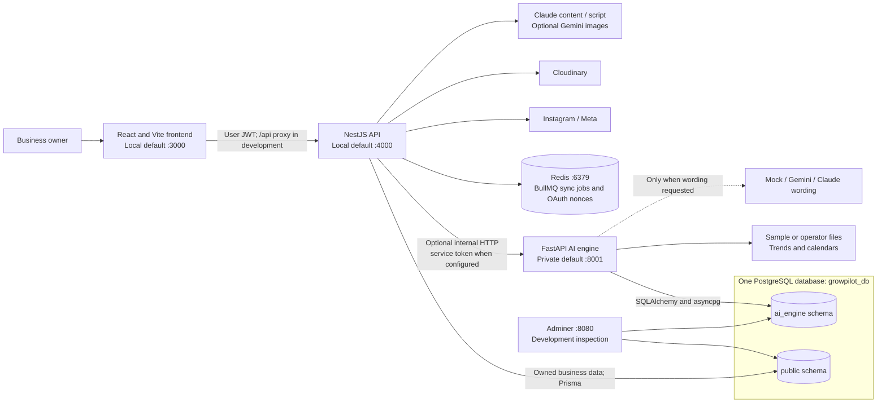
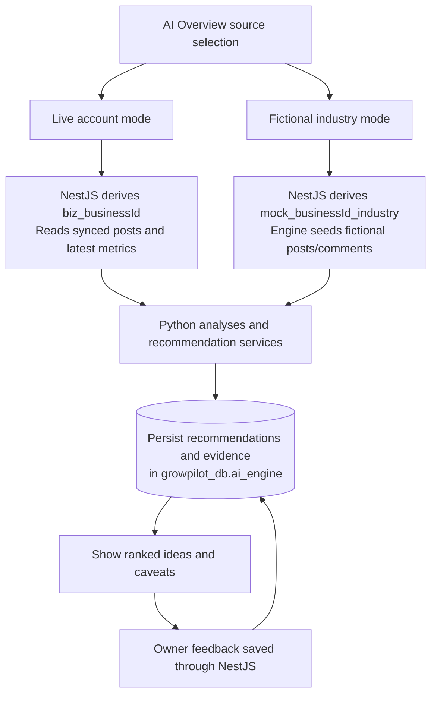

# 01 System Architecture

[Index](README.md) | [Repository](02-repository-architecture.md)

GrowPilot is an organic Instagram workspace for business owners. Three application processes separate browser presentation, business authorization/publication, and Python content intelligence. Generating an idea is never permission to publish it.

## Runtime And Trust Boundaries



There is **no browser-to-engine or browser-to-database connection**. Vite's `/api` proxy strips that prefix; NestJS has no global `/api` prefix. Production must provide a reverse proxy or a suitable browser API base. Port labels are development defaults, not a public firewall policy.

## Ownership

| Component | Owns | Does Not Do |
|---|---|---|
| Frontend | Routes, UI/localization, transient draft state, authenticated HTTP client | Store provider secrets, authorize publication, calculate authoritative AI scores |
| NestJS | Users/business access, products/media/posts/reels, Instagram credentials, sync and publishing | Trust browser-selected AI profile IDs |
| Python | Profile-scoped analytics, signals, ranking, evidence, optional wording, saved intelligence | Instagram OAuth/login, scraping or publication |
| PostgreSQL | Durable backend and AI records | Run the application or make recommendation decisions |
| Redis | Queue coordination and expiring OAuth nonces | Replace PostgreSQL recommendation storage |

Prisma manages only `public`; Alembic manages only `ai_engine`. Sharing a database does not merge application models or migration ownership. Backend `public.recommendations` is a separate model from generated `ai_engine.recommendations`.

## Live Versus Mock Intelligence



The four dashboard industries are fashion, grooming, beauty and cafe. Reload returns saved results/feedback; regeneration appends history. Mock data remains labelled and cannot authorize live publication. The separate frontend `/recommendations` page uses local editorial templates and is not this intelligence flow.

## Verify This Diagram

After following the [setup guide](../../README.md), use read-only probes:

```bash
curl --fail --silent --show-error http://localhost:4000/health
curl --fail --silent --show-error http://localhost:8001/api/v1/health
```

Expected: backend database connected; engine `status=ok` and `storage=postgres`. Backend health does not test Redis or paid providers. For authenticated availability, use `GET /ai-insights/status`; disabled/down state is represented as availability data. Verify saved mock behavior using [workflow checks](08-workflow-sequences.md), not a live publish.

## Evidence And Limits

- [Root Compose](../../docker-compose.yml): shared database, Redis/Adminer and profiled engine.
- [Nest module registration](../../backend/src/app.module.ts), [bridge service](../../backend/src/ai-engine/ai-engine.service.ts): business/service boundaries.
- [Frontend routes](../../frontend/src/App.tsx): browser entry and authentication guard.
- [Engine bootstrap](../../ai-engine/app/main.py): API prefix, secured routers and storage startup.

The bridge is off by default unless configured; `start:all` explicitly enables it. Both applications can remain useful when intelligence is disabled, but successful AI persistence always requires PostgreSQL. External access, model availability and production networking need operator verification. See [deployment](09-deployment-architecture.md).