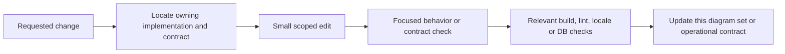

# 02 Repository Architecture

[Index](README.md) | [System](01-system-architecture.md) | [Frontend](03-frontend-architecture.md)

This is a repository containing three application dependency boundaries, not an npm workspace or Nx project. Each Node app has its own manifest/lockfile; Python uses requirements files and an independent virtual environment.

## Source And Documentation Map

```mermaid
flowchart TD
    Root["GrowPilot repository"] --> FE["frontend/"]
    Root --> BE["backend/"]
    Root --> AI["ai-engine/"]
    Root --> Docs["docs/diagram/\nArchitecture and Mermaid only here"]
    Root --> Setup["README.md and TESTING.md\nSetup and safe verification"]
    Root --> Goals["GOALS.md\nPrinciples and labelled roadmap"]
    Root --> Compose["docker-compose.yml\nShared development infrastructure"]
    FE --> FESrc["src/pages, components, hooks\nservices, state, lib, i18n, styles"]
    FE --> FECheck["tests/ and scripts/check-locales.mjs"]
    BE --> BESrc["src/ feature modules\ncontroller, service, repository, DTO"]
    BE --> Prisma["prisma/ and migrations/\nContract, types, seed and history"]
    BE --> BECheck["Colocated specs and test/\nJest and HTTP checks"]
    BE --> Instructions["AGENTS.md and agent skill mirrors\nSafety and version-specific tooling"]
    AI --> AISrc["app/api, services, intelligence\nrecommendation, ai, repositories, db"]
    AI --> AIMigrate["alembic/\nAI-schema migrations"]
    AI --> AICheck["tests/unit, integration, quality\npersistence and opt-in live"]
    AI --> Contracts["docs/\nAPI, algorithm, persistence and provenance contracts"]
```



## Entry Points And Build Inputs

| Area | Entry / Configuration | Generated Or Runtime Output |
|---|---|---|
| Frontend | [main.tsx](../../frontend/src/main.tsx), [App.tsx](../../frontend/src/App.tsx), [Vite](../../frontend/vite.config.ts), [manifest](../../frontend/package.json) | Static `frontend/dist/`; Vite development proxy is not shipped with it |
| NestJS | [main.ts](../../backend/src/main.ts), [AppModule](../../backend/src/app.module.ts), [manifest](../../backend/package.json) | Compiled `backend/dist/`; process also runs sync worker unless configured off |
| Prisma | [config](../../backend/prisma.config.ts), [schema](../../backend/prisma/schema.prisma), [client](../../backend/prisma/db.ts) | Committed [schema.json](../../backend/prisma/schema.json) and [schema.d.ts](../../backend/prisma/schema.d.ts); emission is not migration |
| Python | [main.py](../../ai-engine/app/main.py), [settings](../../ai-engine/app/core/config.py), [requirements](../../ai-engine/requirements.txt) | FastAPI process; no Python dependency lockfile is present |
| Engine startup | [start.sh](../../ai-engine/start.sh), [Dockerfile](../../ai-engine/Dockerfile) | Host migration/reload script or Python-only image; not backend/frontend images |
| Local infrastructure | [Compose](../../docker-compose.yml) | PostgreSQL/Redis volumes; Adminer; optional profiled engine |

Use Node 24.11+ to satisfy current locked Prisma CLI constraints. The engine Docker image uses Python 3.12; choose a compatible local interpreter rather than assuming a formally tested version matrix. Do not copy installed dependency documentation into application architecture policy.

## Editing And Verification Boundaries



The [backend instructions](../../backend/AGENTS.md) govern its work. Agent-directory Prisma skills are vendor-synced references, not proof GrowPilot uses Composer Cloud. Keep schema tools on their own schemas, never reset existing data, and never enable live publication as a test prerequisite.

## Verify This Diagram

From repository root, inspect rather than execute setup/migration scripts blindly:

```bash
node -p 'Object.keys(require("./frontend/package.json").scripts)'
node -p 'Object.keys(require("./backend/package.json").scripts)'
```

Follow the source links above and compare module registration/routes with pages 03/04/05. Use [TESTING.md](../../TESTING.md) to choose tests; never infer that a fixture seed is needed for every suite. The fixture owner is disabled and is not a shared demo login. No root install/build/test script is defined.