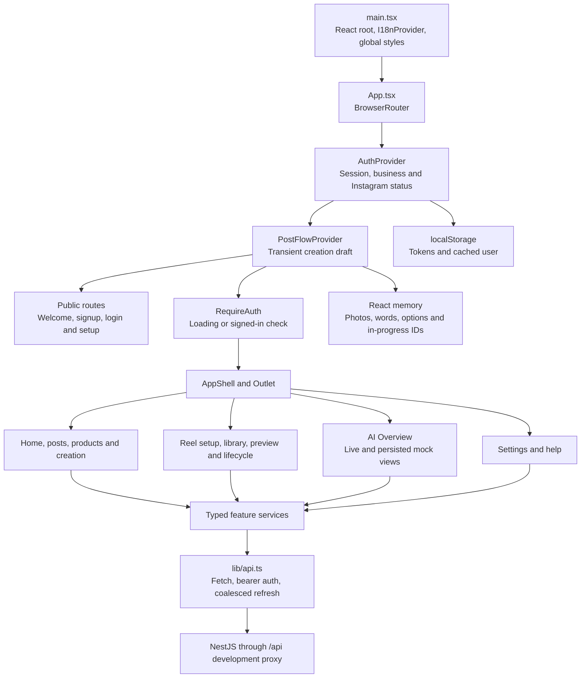
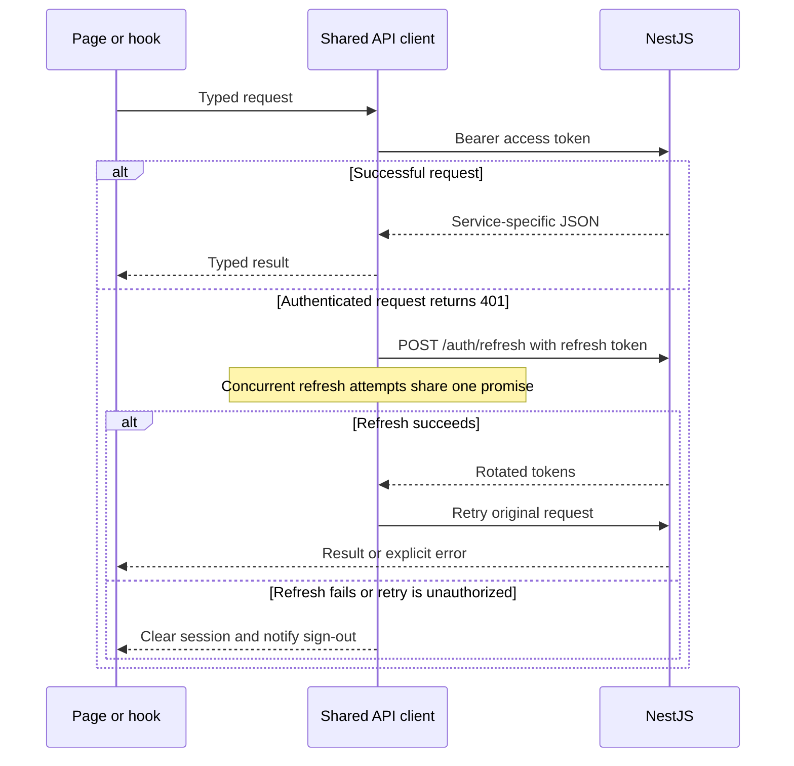
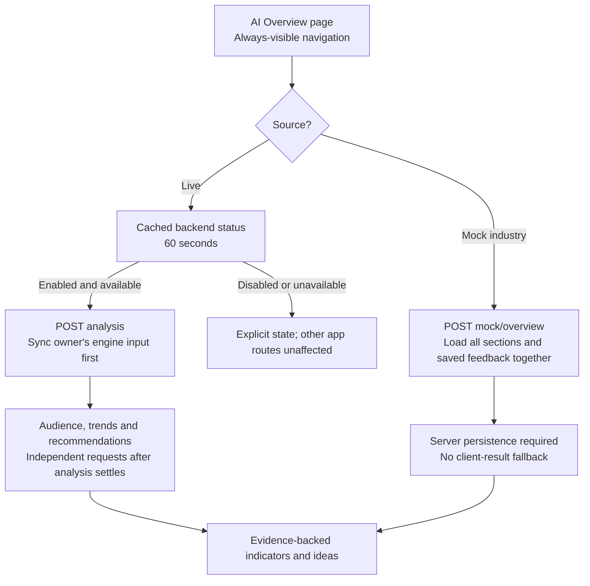

# 03 Frontend Architecture

[Index](README.md) | [Backend](04-backend-architecture.md) | [Workflow sequences](08-workflow-sequences.md)

The frontend is a React SPA with React Router, custom CSS/components and English/Hindi/Marathi JSON resources. There is no SSR layer, Redux/React Query dependency, browser provider SDK or direct engine API.

## Composition And State



The post-flow draft does not survive a full reload. Saved backend posts and PostgreSQL AI recommendations are separate durable records. Signup credentials between onboarding steps stay in memory; access/refresh tokens currently use localStorage rather than HttpOnly cookies. Protect against XSS and log out on shared devices.

## Route Groups

| Access | Routes |
|---|---|
| Public declarations | `/welcome`, `/signup`, `/login`, `/setup` (with its own onboarding checks) |
| Authenticated workspace | `/`, `/posts`, `/products`, `/settings`, `/help`, `/recommendations`, `/ai-insights` |
| Post lifecycle | `/create`, `/create/generating`, `/create/preview`, `/create/publish`, `/create/done` |
| Reels | `/reels`, `/reels/library`, `/reels/:id`, `/:id/generating`, `/:id/edit`, `/:id/publish`, `/:id/published` under `/reels` |
| Redirects | `/reels/new` to `/reels`; unknown paths to `/` |
| Development-only | `/dev/session`, authenticated `/dev/seed`; excluded from production route declarations |

The backend OAuth redirect `/connect/instagram` has no dedicated React route. This is an implementation gap, not an extra route to draw as implemented.

## Authenticated Request Recovery



The shared client is for JSON/application requests. Media players/downloads can fetch returned media URLs directly. Do not assume every media byte passes through NestJS.

## AI Overview Loading



Live feedback is optimistic with rollback on error; mock feedback updates after a successful save. Selecting an industry remounts its preview. Regeneration changes the displayed batch but preserves earlier server rows. The separate `/recommendations` route uses editorial templates, not engine-ranked results.

`VITE_FEATURE_PUBLISHING` is the current frontend capability flag. It never bypasses backend gates. There are no current `VITE_FEATURE_AI` or `VITE_FEATURE_REELS` switches. Browser speech recognition/playback depends on device permissions and support; it is not backend TTS.

## Verify This Diagram

From repository root with dependencies installed:

```bash
npm --prefix frontend run test:unit
npm --prefix frontend run check:i18n
npm --prefix frontend run build
npm --prefix frontend run lint
```

Then sign in locally, verify signed-out redirects, open all route groups, choose live/mock AI sources, save/reload a mock recommendation, and check error states with the engine unavailable. Test on desktop/mobile and in each UI language. Keep publishing disabled. Automated logic/build checks do not replace authenticated browser testing.

Evidence: [route declarations](../../frontend/src/App.tsx), [API client](../../frontend/src/lib/api.ts), [overview hooks](../../frontend/src/hooks/useAiOverview.ts), [auth context](../../frontend/src/state/AuthContext.tsx), [post context](../../frontend/src/state/PostFlowContext.tsx), [Vite config](../../frontend/vite.config.ts), [manifest](../../frontend/package.json).