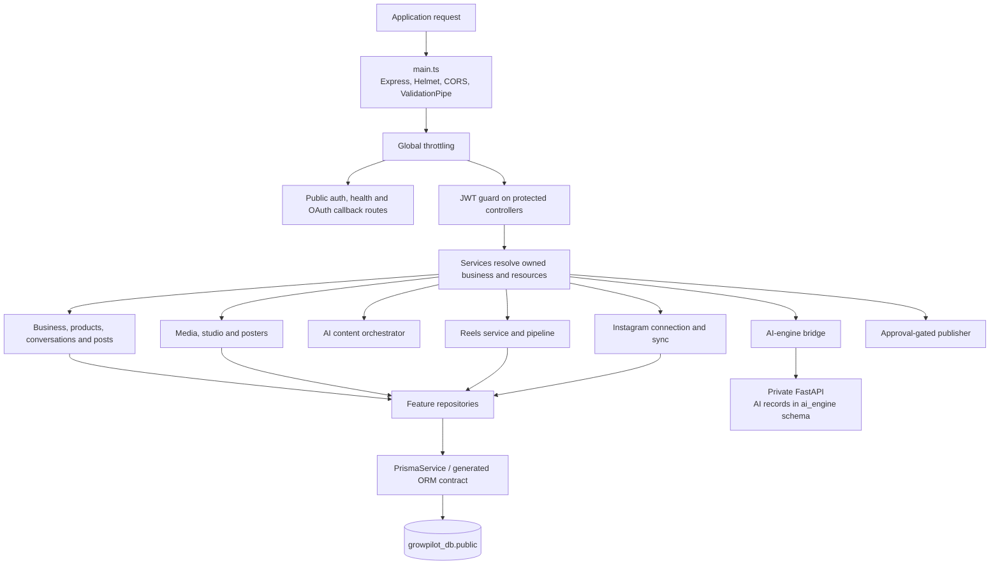
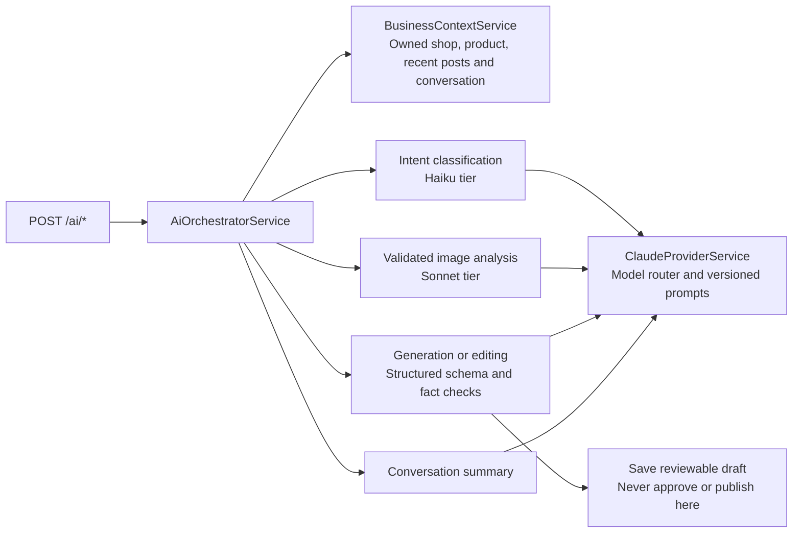
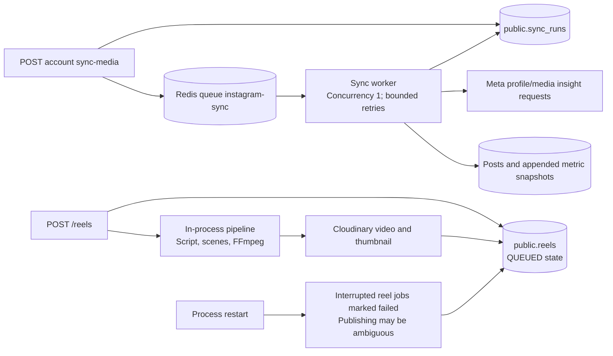

# 04 Backend Architecture

[Index](README.md) | [AI engine](05-ai-engine-architecture.md) | [Database](06-database-architecture.md)

NestJS/Express owns application authorization and external side effects. HTTP defaults to port 4000 with no global `/api` prefix. Helmet, CORS, DTO transformation/whitelisting and a global throttler are registered at bootstrap. Authentication is applied by relevant controllers, not by a global JWT guard. Swagger `/docs` is nonproduction-only.

## Request And Module Boundaries



Controllers return service-specific shapes, not a universal success envelope. End-user IDs come from JWTs; service/repository ownership checks must precede data access or side effects. Public health checks PostgreSQL, not Redis/Meta/AI-provider readiness.

## Content AI Module



Per-request tone is required; caption length/hashtag options are separate. No `business_preferences` table or RAG retrieval is part of this context. Provider model defaults do not certify model entitlement. See the [content API guide](../../backend/src/ai/README.md) for field and error contracts.

## Durable Sync Versus In-Process Reels



The sync queue retries six attempts with exponential backoff; durable run outcomes stay in PostgreSQL. Reels do not gain durable BullMQ execution from using the same API. Their legacy voice fields do not indicate an active TTS stage.

Posters/reels can skip optional Gemini enhancement and keep original photos on absence/quota/timeout/rejected output. Required Claude content, rendering and storage failures remain visible. Poster `cover_card` uses a crop/overlay; framed templates preserve the whole image within a frame. Detailed image contracts remain in the [poster guide](../../backend/src/poster/README.md).

## Publishing Safety Boundary

Publishing requires explicit confirmation, server flag, approved post/reel state, valid/current content and a real connected live account on the server allowlist. Generation and recommendation feedback are not authorization. Posts use `USER_APPROVED`; reels use `APPROVED`. There is no campaign model or separate content-hash approval table. Preserve drafts and do not automatically retry an ambiguous publish. See [sequences](08-workflow-sequences.md) for the actual request order.

## Verify This Diagram

```bash
# From repository root; focused tests use mocked provider/Graph calls.
npm --prefix backend test -- --runInBand --runTestsByPath src/ai-engine/ai-engine.service.spec.ts src/ai-engine/ai-engine.controller.spec.ts
npm --prefix backend test -- --runInBand --runTestsByPath src/reels/reels.service.spec.ts
npm --prefix backend run build
npm --prefix backend run lint
```

Inspect test cleanup before running other database-writing suites, particularly E2E tests. Use Swagger to inspect exact DTOs rather than its stale read-only summary. Keep `ENABLE_LIVE_INSTAGRAM_PUBLISH=false` and do not call live publish endpoints during routine setup.

Evidence: [bootstrap](../../backend/src/main.ts), [modules](../../backend/src/app.module.ts), [content context](../../backend/src/ai/business-context.service.ts), [queue](../../backend/src/instagram/instagram-sync.queue.ts), [reel pipeline](../../backend/src/reels/reel-pipeline.service.ts), [publisher](../../backend/src/publishing/publishing.service.ts), [bridge](../../backend/src/ai-engine/ai-engine.service.ts).