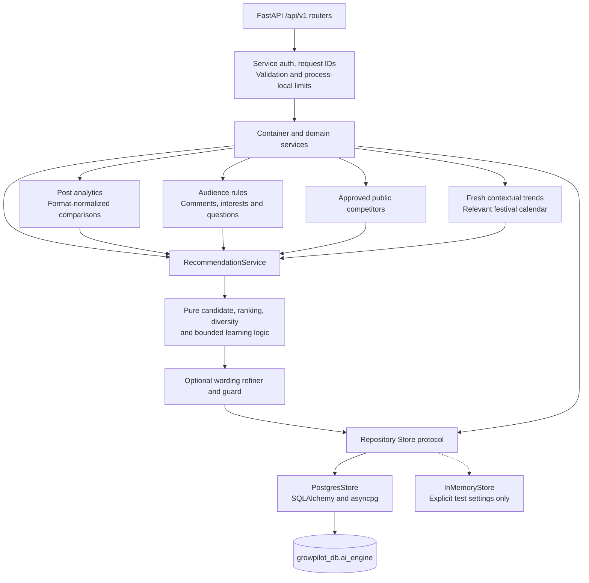
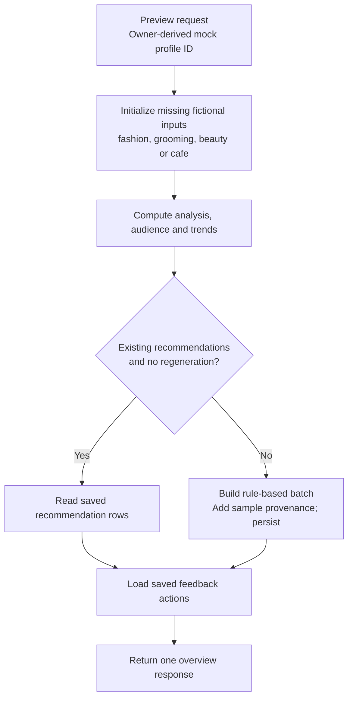

# 05 AI Engine Architecture

[Index](README.md) | [Database](06-database-architecture.md) | [Integrations](07-external-integrations.md)

FastAPI is an internal content-intelligence service, not an Instagram login or publishing service. Python computes ranking and evidence; optional LLM wording is a separate, validated step. Normal application runs require PostgreSQL, including fictional dashboard previews.

## Runtime Layers



Most routes validate and delegate. The saved-preview route is currently an orchestration exception: it seeds missing inputs, loads analyses, builds/saves recommendations if necessary, and assembles saved feedback. It is not proof every controller is logic-free.

## Recommendation Decision Pipeline

```mermaid
flowchart LR
    Inputs["Profile and as_of\nAvailable evidence"] --> Signals["Own posts, audience, approved competitors\nTrends, festivals and goals"]
    Signals --> Candidates["Business or creator strategy\nCandidate ideas and evidence"]
    Candidates --> Score["Opportunity and confidence\nMissing is not zero"]
    Score --> Learning["Bounded feedback/outcome adjustment\nFingerprint suppression"]
    Learning --> Diversity["Topic/format diversity\nEligible time-sensitive reservations"]
    Diversity --> AI{"Wording requested?"}
    AI -->|"No"| Save["Save recommendation batch and evidence"]
    AI -->|"Yes"| Provider["Mock, Gemini or Claude"]
    Provider --> Guard["JSON shape, exact IDs\nLexical wording guard"]
    Guard -->|"Valid"| Save
    Guard -->|"Invalid or provider failed"| Error["Explicit safe error\nNo recommendation batch saved"]
    Save --> Result["Envelope: data and request_id"]
```



Default signal weights are historical .25, audience .20, trend .20, festival .15, competitor .10 and goal .10. Unavailable signals are excluded and remaining weights renormalize; an available zero remains zero. Opportunity is a relative ranking signal, not predicted views or sales. Confidence separately reflects evidence quality and data sufficiency.

Requests normally ask for 3-5 recommendations, default four; fewer can be returned with a limitation note. Reservations for imminent festivals or cross-competitor gaps remain subject to eligibility/deduplication. Learning is transparent arithmetic with minimum samples, shrinkage and bounded adjustments, not model training. [Algorithm details](../../ai-engine/docs/RECOMMENDATION_ENGINE.md) remain a domain contract rather than a second architecture diagram.

Only title, hook, caption direction and CTA are polished. Scores, sources, evidence and dates are not rewritten. A failed wording pass does not save recommendations, but earlier signal collection may already have saved trend snapshots/audience insights. The lexical guard cannot prove semantic truth. This error policy differs from optional NestJS Gemini-image fallback.

## Saved Mock Profiles



There is no unsaved frontend fallback. Reopening a preview recovers missing initialized inputs, reads saved rows and feedback; regeneration appends history. Live profiles use `biz_<businessId>` and mock profiles use `mock_<businessId>_<industry>`. NestJS derives both from the signed-in business.

## Verify This Diagram

From `ai-engine/` with the virtual environment active:

```bash
pytest tests/unit tests/integration
ruff check .
STORAGE_BACKEND=memory python -m app.demos --demo restaurant
```

The demo command explicitly selects memory because its runner constructs test settings without fixing a store; never let it inherit an application PostgreSQL connection. This exception is for tests/demos, not normal runtime. Database restart/isolation checks require the separate disposable database described in [page 06](06-database-architecture.md).

The historical quality report records fictional scenarios. Its corrected header currently differs from the report generator's exact-output template; do not claim the full quality suite passes until that source follow-up is resolved. Live provider/model access and external source truth are not established by unit tests.

## Evidence And Limits

Evidence: [bootstrap](../../ai-engine/app/main.py), [container](../../ai-engine/app/api/dependencies.py), [settings](../../ai-engine/app/core/config.py), [signal orchestration](../../ai-engine/app/services/recommendation_service.py), [generation route](../../ai-engine/app/api/routes/recommendations.py), [saved preview route](../../ai-engine/app/api/routes/profiles.py), [preview data](../../ai-engine/app/data/previews.py), [refiner](../../ai-engine/app/ai/refiner.py).

`as_of` filters future posts/comments and source dates, but current learning, hashtag reuse and some owner-side competitor comparisons are not historical snapshots. Live comments and competitor-dashboard ingestion are incomplete. Sample/file/none trends exist; live discovery, annual calendar refresh and vector/RAG retrieval do not. Rate limits and the store's synchronous-to-async bridge impose deployment constraints; production load capacity is not certified.