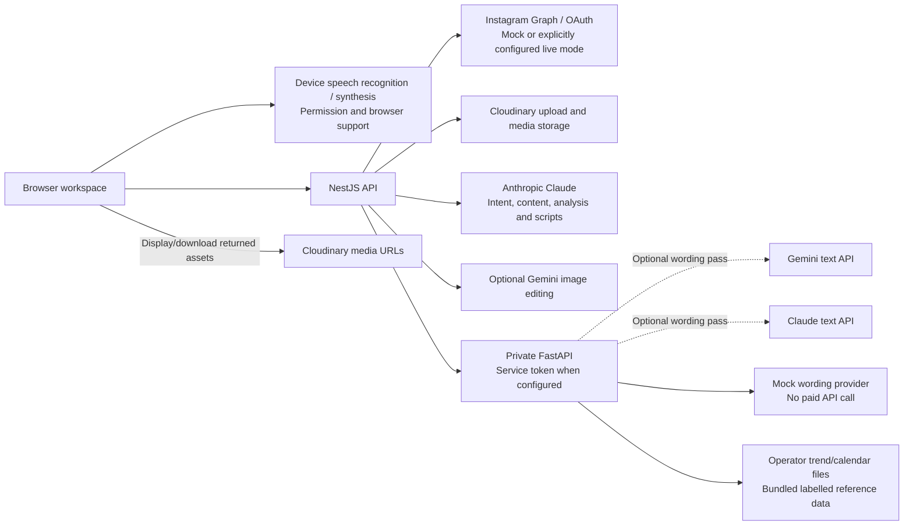
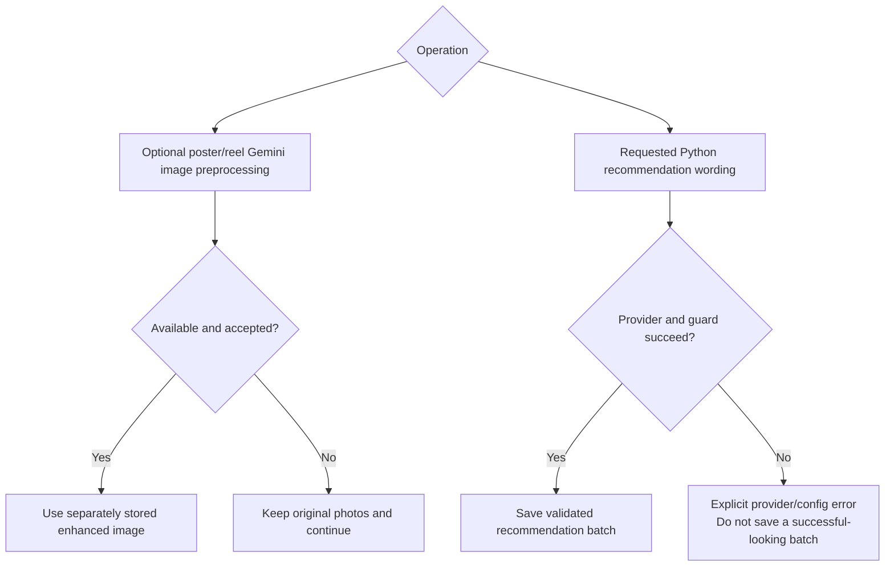

# 07 External Integrations

[Index](README.md) | [Workflows](08-workflow-sequences.md) | [Deployment](09-deployment-architecture.md)

Integrations stay server-side except browser speech and fetching returned media. A running HTTP server does not prove that provider credentials, models, scopes, account entitlements or storage work.

## Callers And Credential Boundaries



NestJS and Python configure providers independently, even when variable names overlap. Browser `VITE_*` variables are public build inputs; never put API/database/service tokens there. Python never receives the owner's Instagram OAuth token.

## Configuration And Failure Contracts

| Integration | Configuration Names / Ownership | Current Failure Or Capability Boundary |
|---|---|---|
| Instagram | Backend `INSTAGRAM_MODE`, app/secret/redirect, encryption key, allowlist; optional Meta-compatible fallback names | OAuth scopes/account permissions are operator-managed. Mock connection cannot publish; queued media sync is live-only |
| Cloudinary | Backend cloud name, API key and API secret | Upload/render workflows needing stored media fail explicitly without working storage |
| Claude creative content | Backend `ANTHROPIC_API_KEY`, Sonnet/Haiku model settings and timeouts | No automatic downgrade from Sonnet to Haiku; missing/invalid required capability is an error |
| Gemini image work | Backend `GEMINI_API_KEY`, image-model settings, timeouts, daily budget and estimated costs | Optional poster/reel preprocessing falls back to original photos. Direct studio editing still reports its own failure |
| Python wording | Engine `AI_PROVIDER`, selected key/model, timeout/retry/output budget | Mock is keyless. Requested real wording failures return explicit errors; rule-only output is not disguised as AI success |
| Internal engine bridge | Backend URL/token, feature flag, timeout/retry/circuit settings | Safe calls can retry; generation and feedback are not automatically retried and are not generally request-idempotent |
| Trends | Engine `TREND_PROVIDER=sample|file|none`, optional `TREND_DATA_FILE` | No automatic Google Trends/social feed; file format/provenance checks do not prove truth |
| Festivals | Optional operator file, bundled verified-source 2027 calendar, fixed rules, optional sample dates | No executable annual refresh; region/moon-sighting caveats remain |
| Browser speech | Device/browser APIs, no backend TTS key | Typed input is the fallback; availability/language quality varies |

The exact variable references and safe templates are [backend example](../../backend/.env.example), [engine example](../../ai-engine/.env.example), [frontend example](../../frontend/.env.example). Real secret files are not documentation input. Provider defaults are repository strings, not proof a model exists for your account.

## Optional Images Versus Required Wording



This is not a universal catch-and-ignore policy. Required upload, render, authorization and publication failures are not suppressed. Earlier signal/audience/trend writes may precede a failed wording pass even when no recommendations are saved.

## Verify Without Paid Or Live Side Effects

```bash
# Repository root: mocked provider transports and failure cases.
npm --prefix backend test -- --runInBand --runTestsByPath src/media/studio/gemini-image.service.spec.ts src/reels/reels.service.spec.ts

# ai-engine/, venv active:
pytest tests/unit/test_ai_provider_scenarios.py
```

Use the saved dashboard mocks with Python's mock wording provider before live data. [TESTING.md](../../TESTING.md) separates mock from explicit live checks. `LIVE_AI_TESTS=1` plus securely exported credentials deliberately opts into engine provider calls and possible costs. Do not run that opt-in or a live publish merely to validate these diagrams.

No payment/advertising integration, automated competitor fetching, Google Cloud TTS stage or configured Observe module is implemented. Counterexamples in old schema comments or generic tooling references are not active integrations. Evidence: [image provider](../../backend/src/media/studio/gemini-image.service.ts), [content config](../../backend/src/ai/ai.config.ts), [publisher](../../backend/src/publishing/publishing.service.ts), [engine provider contract](../../ai-engine/docs/AI_PROVIDERS.md), [data-source contract](../../ai-engine/docs/REAL_DATA_SOURCES.md).