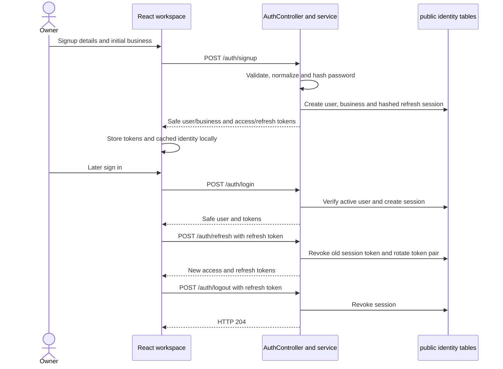
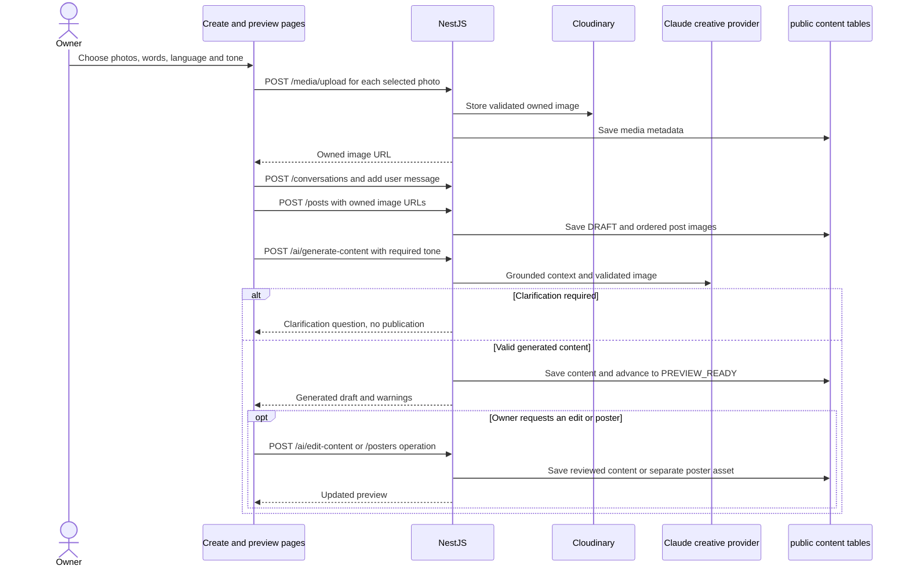
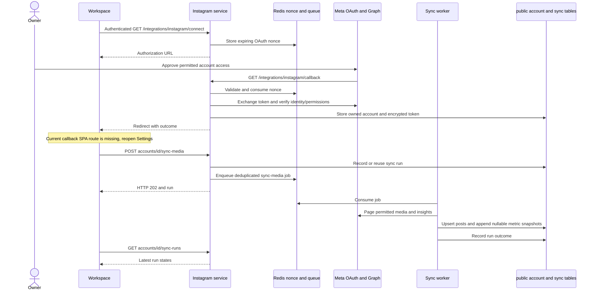
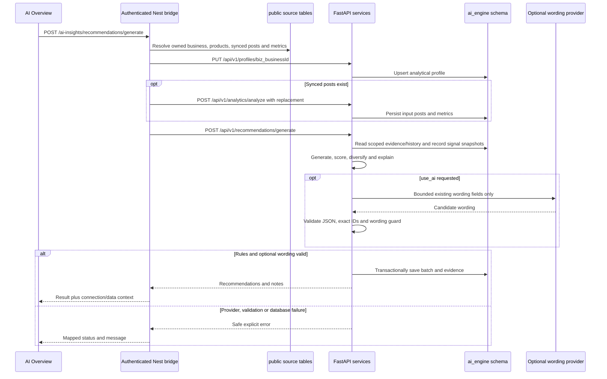
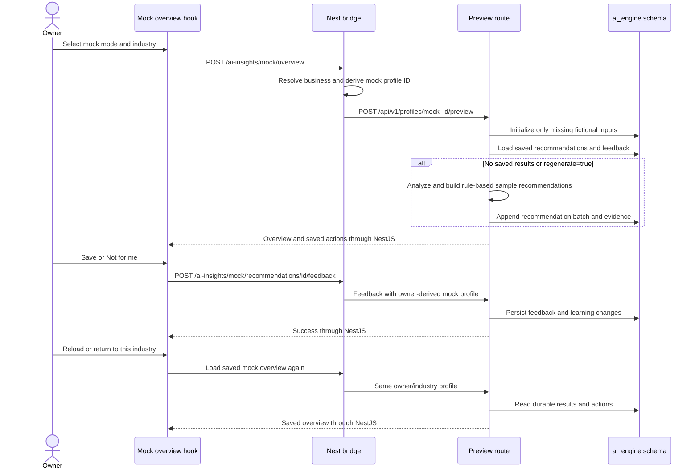
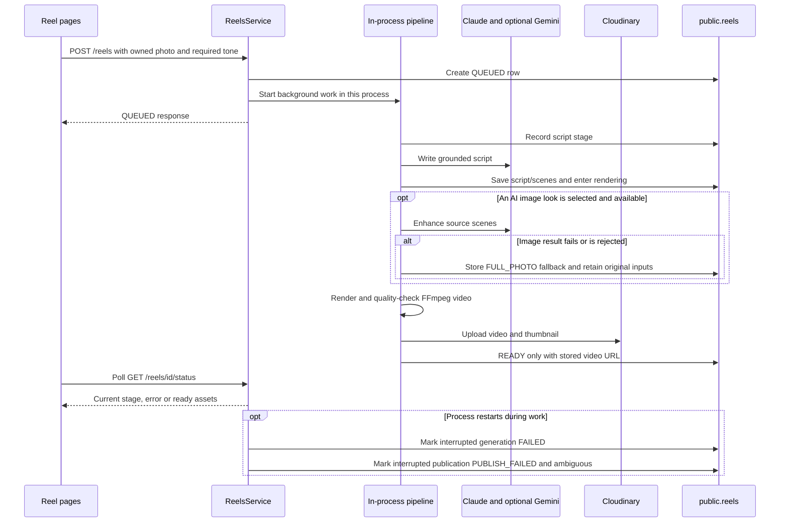
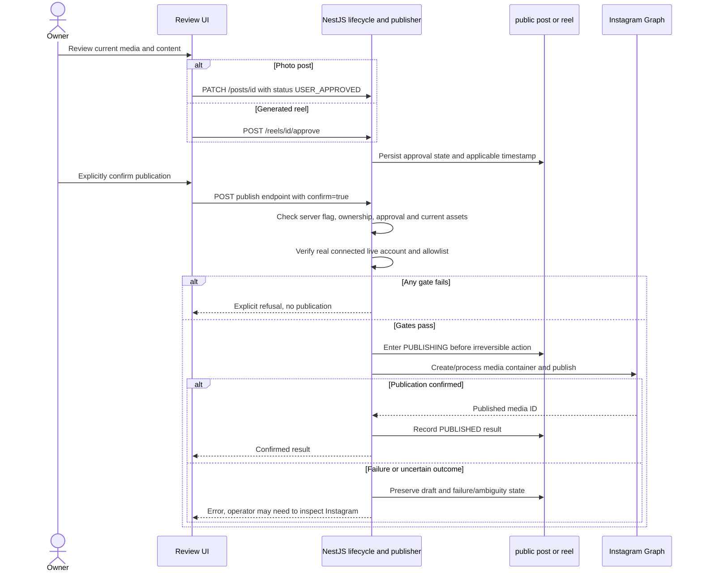

# 08 Workflow Sequences

[Index](README.md) | [Database](06-database-architecture.md) | [Deployment](09-deployment-architecture.md)

Paths in these sequences are backend paths after Vite strips `/api`; internal engine requests include `/api/v1`. Each sequence describes current code, not a claim that external accounts/providers were exercised. Keep publication disabled during ordinary verification.

## 1. Signup, Login And Session Rotation

Signup's business result is not part of the login response. The QA fixture owner is disabled and has no shared password; use signup. The shared frontend client coalesces refresh attempts; see [frontend request recovery](03-frontend-architecture.md).

## 2. Create And Review A Photo Post

The form supports up to ten photos. The empty photo area opens the gallery input; Camera uses the capture input. Generation is not approval. Optional Gemini poster enhancement can fall back to the original photo; required Claude/storage failures do not become fabricated success.

## 3. OAuth And Queued Media Sync

Account endpoint paths above are under `/integrations/instagram`. OAuth flow and media sync are different operations; profile sync is a separate `POST accounts/:id/sync`. Queued media sync is live-only and rejects mock accounts. Mock connection/read checks are described in [TESTING.md](../../TESTING.md). The unmatched frontend callback is an existing gap, not fixed by this diagram.

## 4. Generate Live Recommendations

The browser does not choose the analytical profile ID. Missing comments/competitors remain unknown rather than invented. A failed wording pass does not save recommendations, although earlier snapshot/insight writes can have occurred. Non-idempotent generation is not automatically retried; repeated user requests can create additional batches.

## 5. Persist And Reload A Mock Industry

The four industries are isolated from one another and from live profiles. Regeneration retains old rows; reload does not mean delete/reseed everything. A storage outage must show an error, not local-only recommendations. Counts are usage-dependent, not a fixed number guaranteed by migration.

## 6. Generate And Recover A Reel

There is no active voiceover/TTS stage. Cancellation is observed between pipeline stages; regeneration clears approval/staleness as needed. This is not a durable queue that resumes unfinished render work after a restart.

## 7. Approval And Publication (Opt-In Live Operation)

Post and reel publication use `/posts/:id/publish` and `/reels/:id/publish`. The post DTO can also request a slideshow `format=reel`; this is distinct from generated `/reels` resources. Posters become the cover slide followed by source photos, capped at ten slides. No separate hashed approval/campaign table exists. Never automatically retry a potentially completed publish.

## Verification Matrix

| Sequence | Safe Check | Expected Evidence / Prerequisites |
|---|---|---|
| Auth | Signup/login/refresh/logout through local UI or Swagger | Owned identity; tokens rotate; no hashes returned; no seeded shared login |
| Post creation | Upload a test product image, choose tone, generate/review without publishing | Separate media/draft rows; Claude/Cloudinary credentials are needed for actual generation/storage |
| Sync | Mock connection/read checks first; queue live sync only for an explicitly authorized test account | `sync_runs`, imported posts and appended metric snapshots; Meta permissions for live sync |
| Live intelligence | Call analysis/generation after owned posts sync; leave `useAi=false` initially | Profile-scoped evidence and saved AI recommendations; no paid wording call required |
| Mock intelligence | Select each industry; save, reload, regenerate and inspect schema `ai_engine` | Same saved actions after reload; additional batches retained; no Meta/paid wording required |
| Reel | Mocked `reels.service.spec.ts` first; actual render only with configured media/provider dependencies | READY includes a stored video; optional Gemini failures use originals |
| Publication | Test mocked gate/ambiguity suites with live flag false | Routine tests must not invoke real publication; live verification is a separate approved operation |

For detailed commands and disposable-database restrictions use [TESTING.md](../../TESTING.md). Evidence: [auth controller](../../backend/src/auth/auth.controller.ts), [post service](../../backend/src/posts/posts.service.ts), [publishing DTO](../../backend/src/publishing/publishing.dto.ts), [publisher](../../backend/src/publishing/publishing.service.ts), [Instagram controller](../../backend/src/instagram/instagram.controller.ts), [AI bridge](../../backend/src/ai-engine/ai-engine.service.ts), [preview route](../../ai-engine/app/api/routes/profiles.py), [reel lifecycle](../../backend/src/reels/reels.service.ts), [reel pipeline](../../backend/src/reels/reel-pipeline.service.ts).