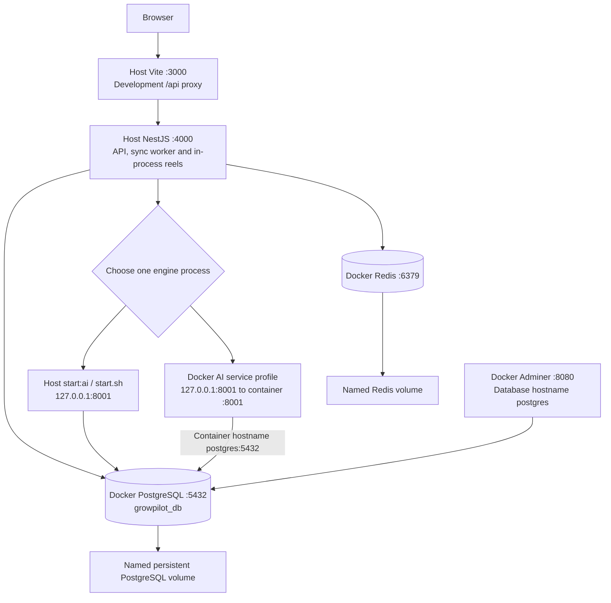
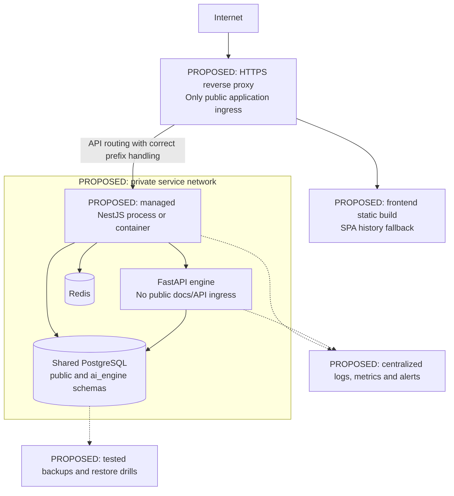

# 09 Deployment Architecture

[Index](README.md) | [System](01-system-architecture.md) | [Workflow checks](08-workflow-sequences.md)

There is one root development Compose file and one Python Dockerfile. There is no complete backend/frontend container build, TLS/reverse-proxy stack, production backup system or deployed VPS manifest in this repository. Do not mistake the proposed topology below for installed infrastructure.

## Implemented Local Development Topology



Host processes use host addresses; Docker services use service DNS such as `postgres`. A container's `localhost` is not another container. The Python process shares the database but writes its own `ai_engine` schema. Uploaded media bytes live in Cloudinary, not these database volumes.

Root Compose normally starts PostgreSQL/Redis/Adminer. The `service` profile adds the Python image, database health dependency and migration-before-Uvicorn command. Optional `ai-engine/.env` is loaded, then storage/shared URL/`LOAD_MOCK_DATA=false` are overridden. Production environment/auth are not forced. PostgreSQL/Redis/Adminer have exposed development ports; engine alone is bound to loopback.

## Supported Local Startup Choices

Complete the [root installation and schema prerequisites](../../README.md) first. These are instructions, not commands executed by this documentation change.

### Separate Host Terminals (Recommended For Debugging)

```bash
# Repository root: infrastructure only.
docker compose up -d

# Terminal A, from repository root:
AI_ENGINE_ENABLED=true ENABLE_LIVE_INSTAGRAM_PUBLISH=false npm --prefix backend run start:dev

# Terminal B: existing ai-engine/.venv and shared local database required.
npm --prefix backend run start:ai

# Terminal C:
npm --prefix frontend run dev
```

`start:ai` forces PostgreSQL and runs Alembic first, using root development defaults unless `DATABASE_URL` is exported. Configure matching Python `SERVICE_TOKEN` and backend `AI_ENGINE_SERVICE_TOKEN` when using service authentication. Bare Uvicorn instead needs explicit valid persistent settings. The host script is a reload/development command, not a production process manager.

### Docker Engine Plus Host Node Apps

```bash
# Repository root; do not also run the host AI engine on 8001.
docker compose --profile service up -d --build
AI_ENGINE_ENABLED=true ENABLE_LIVE_INSTAGRAM_PUBLISH=false npm --prefix backend run start:dev
# Start frontend in another terminal:
npm --prefix frontend run dev
```

`npm --prefix backend run start:all` is the development convenience for this second shape: it first kills listeners on hard-coded ports 4000/3000, tries Docker Desktop startup, builds/starts Compose, then runs the frontend/backend. Use separate terminals on shared machines. `stop:all` does not stop Docker services, and neither command coordinates arbitrary custom ports. Do not run these destructive-to-listeners convenience scripts blindly on a VPS.

## Proposed Hardened VPS Boundary (Not Implemented)



This proposal requires additional deployment configuration and backend/frontend build packaging. It does not imply Caddy/Nginx, certificates, domains, firewall rules or monitoring are already configured. Database and cache ports must not be public; Adminer should be restricted to trusted administration access, not public ingress.

Before a real VPS release:

1. Provision actual secrets, private networking, DNS/TLS and final frontend API/CORS origins. Do not use committed development database credentials.
2. Set Python `ENVIRONMENT=production`, explicit PostgreSQL URL and matching service authentication. Keep the engine, `/docs` and `/openapi.json` private. Avoid application-memory settings.
3. Apply Prisma's `public` and Alembic's `ai_engine` migrations as controlled, reviewed release steps. Back up the shared database, preserve both schemas, and rehearse restore.
4. Build/serve the frontend with its final public `VITE_API_BASE`; Vite's development proxy is not in the built assets. Never put secrets in `VITE_*` values.
5. Run NestJS with a suitable process/container manager and the imported `ffmpeg-static` binary available for its platform. Install required fonts for Devanagari rendering. Test media pipelines with actual approved dependencies before relying on them.
6. Monitor PostgreSQL, Redis queue failures/backlog, sync outcomes, provider budget/errors, HTTP latency and render failures. Health is not an end-to-end publishing proof.
7. Keep live publishing off until an explicitly authorized live test proves the separate approval/account/Meta gates. Define raw-comment/media retention, deletion handling and credential rotation.

Source does not establish a universal VPS RAM requirement, measured capacity or paid-provider entitlement. Benchmark the actual workload and media rendering on the target machine.

## Verify Startup And Networking

```bash
docker compose ps
curl --fail --silent --show-error http://localhost:4000/health
curl --fail --silent --show-error http://localhost:8001/api/v1/health
```

Expect PostgreSQL-connected backend health and engine `storage=postgres`. Check authenticated `/ai-insights/status`, sign in to the frontend, then run the saved-mock smoke scenario from [page 08](08-workflow-sequences.md). Verify errors when the engine is unavailable without assuming the entire app must fail.

Stop host processes with Ctrl+C in their own terminals; `docker compose stop` stops containers without deleting volumes. Never use volume-removal/reset flags to fix login, missing-table, migration or password problems. Existing PostgreSQL volumes retain initialized credentials; changing Compose environment alone does not rotate them.

Evidence: [Compose](../../docker-compose.yml), [Python image](../../ai-engine/Dockerfile), [host startup](../../ai-engine/start.sh), [backend scripts](../../backend/package.json), [frontend build/proxy](../../frontend/vite.config.ts), [engine settings](../../ai-engine/app/core/config.py), [Prisma config](../../backend/prisma.config.ts).